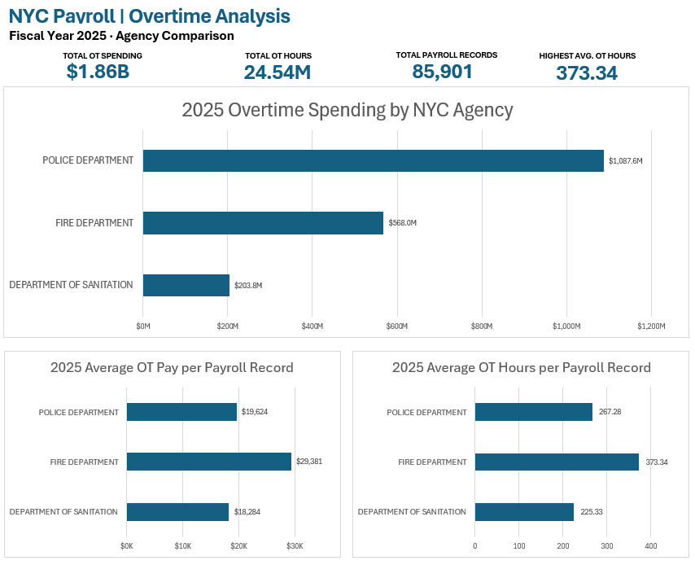
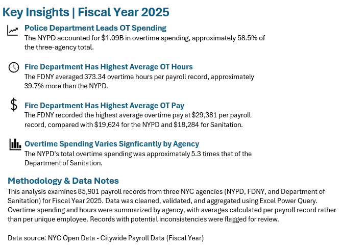
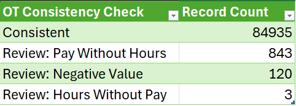
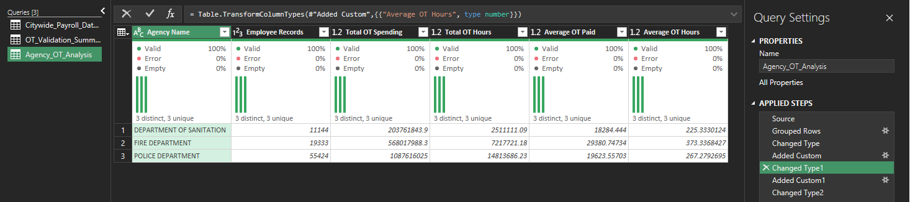

# NYC Payroll Overtime Analysis | Fiscal Year 2025

## Project Overview
This project examines overtime spending and hours across three New York City agencies: the Police Department (NYPD), Fire Department (FDNY), and Department of Sanitation (DSNY), using fiscal year 2025 payroll records.

I used **Microsoft Excel and Power Query** to prepare and validate the data, aggregate agency-level metrics, and create a dashboard highlighting differences in overtime spending and hours.

## Business Questions
- Which selected agency has the highest total overtime spending?
- How does median overtime pay per payroll record compare across agencies?
- Which agency has the highest average overtime hours per payroll record?
- What potential data-quality exceptions appear in the records?

## Tools and Skills
- **Excel:** dashboard design, KPI summaries, charts, and formatting
- **Power Query:** data preparation, data types, grouping, and aggregation
- **Data validation:** consistency checks and exception counts
- **Data storytelling:** comparisons and actionable summaries

## Dataset and Scope
- **Source:** NYC Open Data — Citywide Payroll Data (Fiscal Year)
- **Fiscal year:** 2025
- **Agencies:** NYPD, FDNY, and DSNY
- **Payroll records analyzed:** 85,901

**Note:** A payroll record is not necessarily a unique employee. Per-record metrics should not be interpreted as per-employee metrics.

## Data Preparation and Validation
1. Imported the FY2025 payroll data into Excel Power Query.
2. Reviewed and transformed column types.
3. Flagged potentially inconsistent overtime pay and hours.
4. Aggregated payroll records, overtime spending, and overtime hours by agency.
5. Calculated median overtime pay and average overtime hours per payroll record.
6. Built an Excel dashboard to communicate the results.

### Overtime Consistency Check

| Validation category | Records |
|---|---:|
| Consistent | 84,935 |
| Review: Pay Without Hours | 843 |
| Review: Negative Value | 120 |
| Review: Hours Without Pay | 3 |
| **Total** | **85,901** |

**966 records** were flagged for review. A flag indicates a potential inconsistency, not necessarily an error. The reported agency totals cover all 85,901 records.

## Dashboard KPIs

| Metric | Value |
|---|---:|
| Total overtime spending | $1.86B |
| Total overtime hours | 24.54M |
| Payroll records | 85,901 |
| Highest agency average OT hours per payroll record | 373.34 |

## Agency Comparison

| Agency | Payroll records | OT spending | OT hours | Median OT pay per record | Average OT hours per record |
|---|---:|---:|---:|---:|---:|
| NYPD | 55,424 | $1,087.6M | 14.81M | $19,624 | 267.28 |
| FDNY | 19,333 | $568.0M | 7.22M | $29,381 | 373.34 |
| DSNY | 11,144 | $203.8M | 2.51M | $18,284 | 225.33 |

*Values are rounded for presentation. The median OT pay metric is based on the Power Query median aggregation, not the arithmetic mean.*

## Key Findings
1. **NYPD led total overtime spending**, with approximately $1.09B, or 58.5% of the three-agency total.
2. **FDNY had the highest average overtime hours**, at 373.34 hours per payroll record—approximately 39.7% higher than NYPD.
3. **FDNY had the highest median overtime pay per payroll record**, at approximately $29,381.
4. **Agency size and per-record intensity differ:** NYPD had the largest total overtime spending and record count, while FDNY led the per-record metrics shown.

## Dashboard Preview



### Key Insights


### Data Validation


### Power Query Transformation


## Repository Structure

```text
Payroll-Analytics-Project/
├── README.md
├── data/
├── documentation/
├── excel/
│   └── NYC_Payroll_Analysis_2025.xlsx
└── screenshots/
    ├── nyc_overtime_dashboard.png
    ├── key_insights.png
    ├── data_validation.png
    └── power_query_transformation.png
```

## Limitations
- Findings apply only to the three selected agencies, not all NYC agencies.
- The analysis is descriptive; it does not establish the causes of overtime differences.
- Flagged records warrant review before being classified as errors.
- Payroll records are not equivalent to unique employees.
- Power Query source file paths may need updating on another computer.

## Data Source
[NYC Open Data — Citywide Payroll Data (Fiscal Year)](https://data.cityofnewyork.us/City-Government/Citywide-Payroll-Data-Fiscal-Year-/k397-673e)
